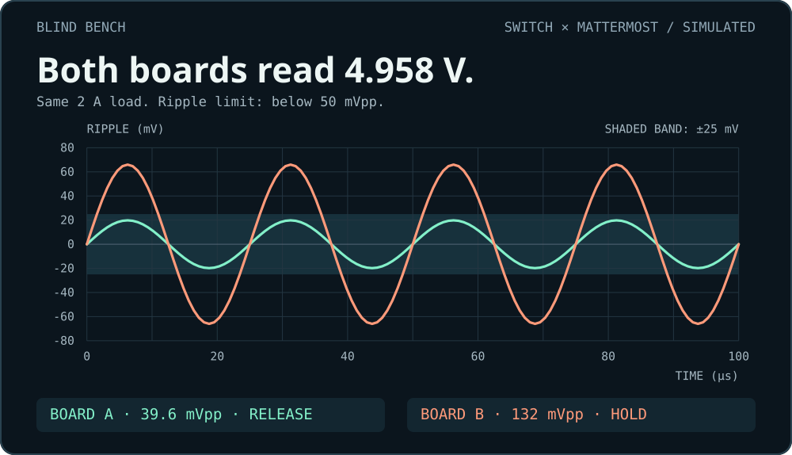
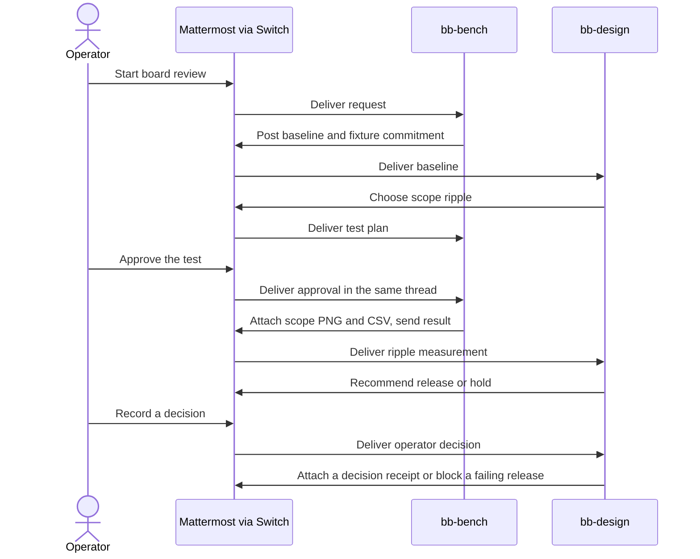

# Blind Bench

**Both boards read 4.96 V. Which one would you ship?**

Blind Bench puts a hardware release review in a Mattermost thread. A design agent asks for the missing measurement, an operator approves it, and a bench agent returns the scope capture and raw samples. The final release or hold attaches a decision receipt tied to the exact CSV and the Switch events that led to it.

**Flip the Switch · Best Business Workflow** · [Open evidence review](https://shaangs.github.io/blind-bench/) · [Inspect the HOLD receipt](evidence/board-3bcb9e-decision.json) · [Run with Switch](#run-locally)



## Inspect the recorded runs

[Open the evidence review in your browser](https://shaangs.github.io/blind-bench/). Toggle the traces on a shared scale, expand the actual Mattermost posts, and download each board’s CSV. For offline use, open [the review HTML](docs/index.html) on GitHub, choose **Download raw file**, and open it locally.

The review recalculates DC and peak-to-peak ripple from all 256 samples per board. It checks the fixture reveal, decision order, and SHA-256 of the CSV against the receipt. Board B’s thread shows the attempted release and its rejection. A receipt appears only when the operator records the permitted hold.

| Simulated fixture | DC at 2 A | Ripple (limit < 50 mVpp) | Recorded decision | Evidence |
| --- | ---: | ---: | --- | --- |
| A | 4.958 V | 39.6 mVpp | **Release** | [Scope](evidence/board-b1c3bc-scope.png) · [CSV](evidence/board-b1c3bc-samples.csv) · [Receipt](evidence/board-b1c3bc-decision.json) |
| B | 4.958 V | 132 mVpp | **Hold** | [Scope](evidence/board-3bcb9e-scope.png) · [CSV](evidence/board-3bcb9e-samples.csv) · [Receipt](evidence/board-3bcb9e-decision.json) |

[Read the original rehearsal export](evidence/rehearsal.json). Its thread URLs point to the local rehearsal instance. The browser checks consistency within this export and its CSVs. The live rehearsal also exercised an approval sent in the wrong thread.

## What Switch does

`setup_room.py` registers two custom agents with the Switch Agent API and creates a private **Blind Bench** channel on the Mattermost bridge. The two bots and the seeded `operator` account are members.

- **`bb-design`** invokes Claude Code with Haiku and tools disabled to choose the next test. It receives the common DC reading, the limits, and the available tests. It receives the ripple measurement only after the operator authorizes the bench test.
- **`bb-bench`** runs the simulator after approval and attaches a scope PNG and sample CSV to the same thread. It commits to the privately armed fixture before the test plan and reveals it with a nonce after the measurement.
- **`operator`** starts the run, approves the test, and records the final decision. The code compares measured ripple with the limit and rejects a release for a failing board.

Switch delivers addressed messages to the agents over WebSocket. The agents send targeted handoffs, post replies, and upload files through the Switch API. Each action checks the sender and thread against the run. The decision receipt carries the Switch room, thread, approval, measurement handoff, and operator decision IDs. Both waveforms are deterministic simulations. A recorded release is a decision in the chat.



## Run locally

Install Python 3.11+, Docker with Compose v2, and Claude Code. Sign in to Claude Code with access to Haiku. Run these commands from the repository root to prepare the tested Switch 0.31.0 release and generate credentials on your machine.

```sh
python init_switch.py
cd runtime/switch
docker compose -p blind-bench --profile collab --profile gateway up -d
docker compose -p blind-bench --profile collab --profile gateway ps -a
cd ../..
```

Wait until the `setup` service has exited with code 0. The Compose stack includes Mattermost and seeds the operator account. You can also use an existing compatible [Switch self-hosted deployment](https://docs.switchagents.ai/switch-rooms/deploy/self-host) with the Mattermost bridge active. Pass its Compose environment file to `setup_room.py`.

```sh
python -m pip install -r requirements.txt
python setup_room.py --env runtime/switch/.env --runtime runtime/agents
```

Run one agent in each of two terminals and wait for each to print `ready`.

```sh
python run.py --runtime runtime/agents agent bb-bench
```

```sh
python run.py --runtime runtime/agents agent bb-design
```

On Windows you can start both agents with `.\start_agents.ps1 -Runtime runtime/agents`. Open the Mattermost URL printed by `setup_room.py` and sign in as `operator` using `MATTERMOST_USER_PASSWORD` from `runtime/switch/.env`.

## Try the two boards

Arm the fixtures from a terminal. Use a fresh run ID for every attempt.

```sh
python run.py --runtime runtime/agents arm board-a clean
python run.py --runtime runtime/agents arm board-b noisy
```

1. Post `@bb-bench start board-a` in the channel. Wait for the design agent's test plan and the bench agent's approval prompt.
2. Reply in that post's thread with `@bb-bench run board-a`. After the recommendation appears, record `@bb-design decide board-a release`.
3. Repeat in a new thread for `board-b`. After its recommendation, `@bb-design decide board-b release` is blocked. Record `@bb-design decide board-b hold` to close the run.

The agents keep in-progress state in memory. If an agent disconnects or restarts, arm a fresh run ID.

## Verify both outcomes

```sh
python rehearse.py --env runtime/switch/.env --runtime runtime/agents --evidence runtime/rehearsal
```

The rehearsal posts through the Mattermost API and waits for the agents' real replies. It downloads the scope, CSV, and receipt, recalculates ripple, and checks the receipt against the CSV bytes. It also tests a measurement in the wrong thread, a repeated measurement, a release attempt on the failing board, and a repeated final decision.

To audit the committed evidence without running Switch, use Node.js 24. The check runs offline without package installation and is used by CI on Linux and Windows.

```sh
npm run judge-check
```

Run `node review/build.mjs` to regenerate the portable HTML and README graphic from the committed evidence.
